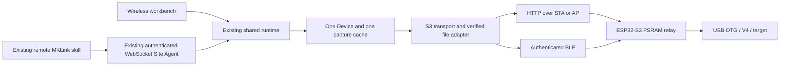

# S3 wireless adapter — shared backend integration

Baseline: microkeen/main 3cc474bb (0.4.1). The existing runtime, client sessions,
Site Agent protocol, GUI bridge, resource admission and job journal are retained.

“Shared session” means one backend/device with distinct client sessions and
independent cursors. Closing one consumer must not stop another consumer's capture.
Local WebSocket uses loopback plus a separate Site Agent token. WSS requires a
validated TLS endpoint; no public listener or certificate changes are implied.

The adapter identifies a node independently from its HTTP/BLE address. A live
backend prevents route/credential replacement. A command with unknown outcome
poisons the transport; no automatic reconnection, mutation replay or USB fallback.
S3 firmware currently accepts BIN/FLM files up to 1 MiB. Local CMSIS-DAP, MSC and
UF2 paths remain unavailable for this transport.

## Validation on 2026-10-28

Real hardware: ESP32-S3 firmware 0.7.2, V4 firmware 4.7.2 and STM32F411.
STA and AP use an ESP32-C6 radio fixture over USB/loopback. The PC WLAN
configuration is not changed. BLE uses the PC adapter.

| Surface | STA | BLE | AP |
|---|---|---|---|
| Workbench + actual stdio remote MCP, same backend, UID | Pass | Pass | Pass |
| Target RAM challenge and firmware acknowledgment | Pass | Pass | Pass |
| RTT bidirectional echo and heartbeat | Pass | Pass | Pass |
| SuperWatch, no read errors/drops | 48 cycles | 50 cycles | 49 cycles |
| Trace parsed events / source bytes | 10485 / 73416 | 8351 / 58477 | 16628 / 115735 |
| Flash APP with full verification, Boot/options preserved | 390.89 s | 325.86 s | 282.99 s restore + full 512 KiB comparison |
| MCP RTT subscriber survives workbench detachment | UID-only detach checked | Pass | Pass |

Capture counters are short functional windows, not equal-duration throughput
benchmarks or USB Full-Speed ceilings. All three Trace receipts report zero
parser drops and target overflow events. Flash times include staged upload and
verification; cached artifacts and fixture overhead differ between runs.

Software checks: 346 relevant Python tests passed, followed by 85 targeted
entry/site tests after adding the packaged existing remote MCP entry. Frontend 18 tests and
production builds passed. Native Tauri WebView2 automation read the real target
through the frozen sidecar. The workbench opens the existing GUI in the system
browser; Playwright verified the connected browser UI. Embedding that GUI in a
foreign Tauri window incorrectly selected its own native IPC and was removed.
The packaged remote-mcp entry also read the actual target over BLE.

The S3 registration gives only its site a 60-second RPC and 1200-second flash
budget. Existing USB site defaults remain 10/300 seconds. Live route, token or
budget changes require explicit reconnect. No automatic mutation replay is added.

Review fixes cover old-FLM fallback, reconnect after uncertain I/O, ownership
release before local I/O settles, stale site credentials, malformed registry
isolation and wireless capture-stop deadlines. Tests exercise these boundaries.

Target original 512 KiB and borrowed C6 original 16 MiB were restored and verified.
S3 original AP configuration is restored and temporary STA credentials cleared.
The final browser handoff passed. Local workbench packaging is tracked in its
own delivery report; this task is not a full upstream release qualification.
No public release, production skill replacement or firmware update is implied.
